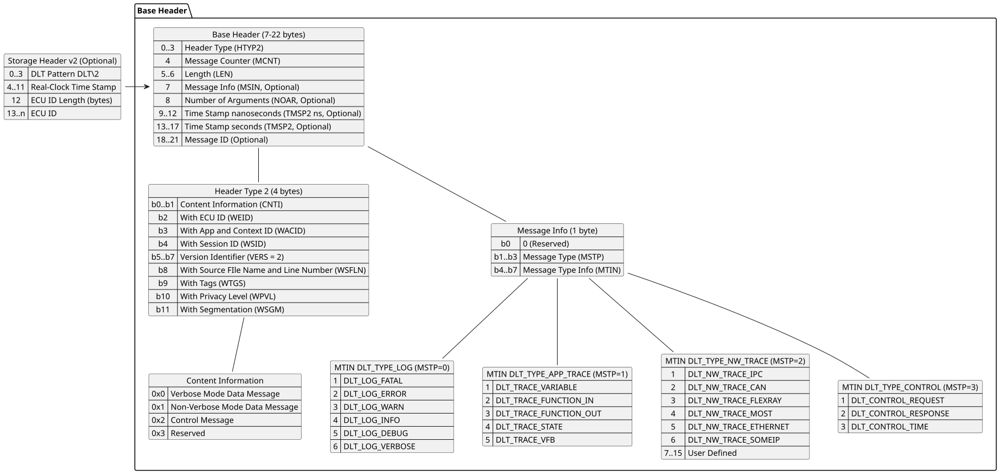
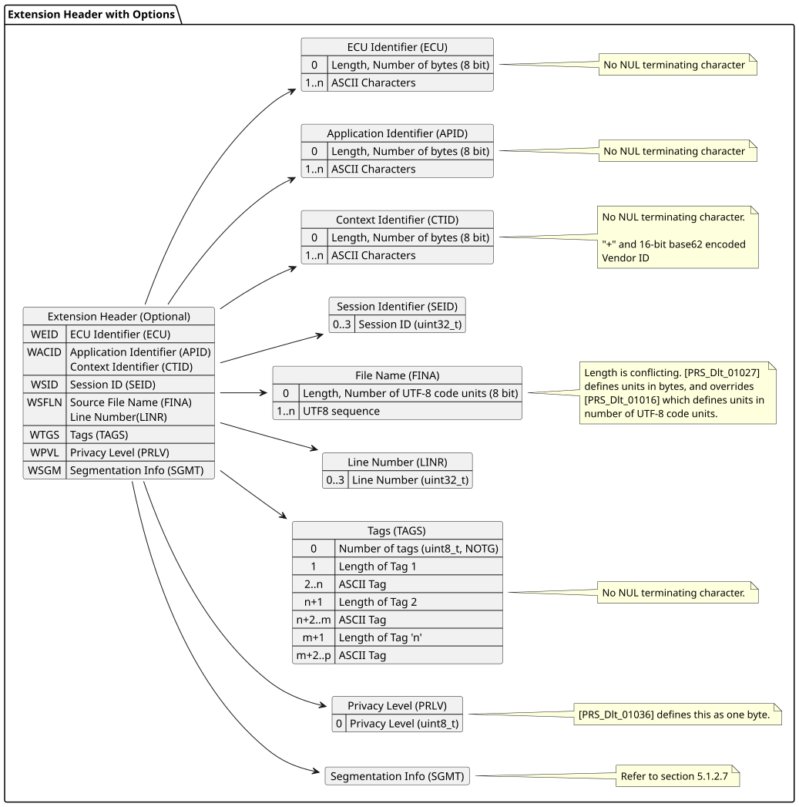
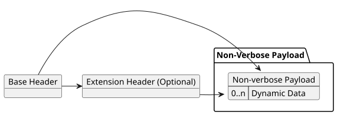
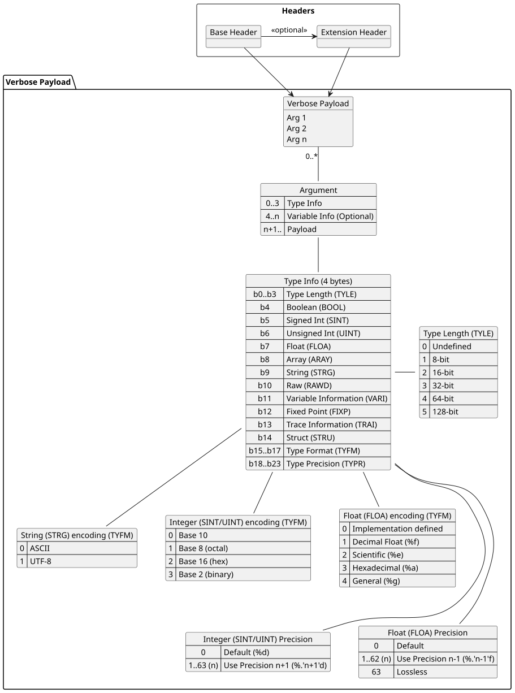

# Introduction - DLT Format <!-- omit in toc -->

This document tries to capture at a high level the protocol format. Specific details of the
DLT format should be obtained by the relevant specifications.

- [1. DLT Version 1](#1-dlt-version-1)
  - [1.1. Dissecting a DLT Version 1 Packet](#11-dissecting-a-dlt-version-1-packet)
- [2. DLT Version 2](#2-dlt-version-2)
  - [2.1. The Base Header](#21-the-base-header)
  - [2.2. The Extension Header](#22-the-extension-header)
  - [2.3. The Non-Verbose Payload](#23-the-non-verbose-payload)
  - [2.4. The Verbose Payload](#24-the-verbose-payload)
  - [2.5. Notable Comparison to DLT v1](#25-notable-comparison-to-dlt-v1)
    - [2.5.1. Time Stamp](#251-time-stamp)
    - [2.5.2. Message Type, Info, Number of Arguments](#252-message-type-info-number-of-arguments)
    - [2.5.3. Non-Verbose](#253-non-verbose)
    - [2.5.4. Verbose](#254-verbose)
    - [2.5.5. Control Messages](#255-control-messages)
    - [2.5.6. Segmentation](#256-segmentation)

The following sections show diagrams of the structure of DLT packets. These
diagrams are useful when reading DLT binary. The condensed form can make it
easier to dissect byte packets manually for debugging and packet construction.

The Storage Header is recorded in case that data is recorded from an external
device and stored to persistent medium (e.g. disk). This is attached by the
logger itself, and not emitted by the device doing the logging.

## 1. DLT Version 1

Version 1 of the DLT protocol which is defined up until
[R20-11](https://www.autosar.org/fileadmin/standards/R20-11/FO/AUTOSAR_PRS_LogAndTraceProtocol.pdf)

### 1.1. Dissecting a DLT Version 1 Packet

The DLT v1 packet consists of:

- A storage header (for files recorded from a DLT talker)
- A standard header
- An extended header
- A payload

The storage header is optional, and contains information on when the data was
recorded. It is the format for on disk DLT logs.

A standard header provides information about the DLT payload. It describes the
features.

An extended header contains optional information, which is typically present for
verbose DLT logging.

If the Extended Header is not provided, it is assumed that the packet is
non-verbose. Therefore, all verbose DLT messages must have the extended header
(but having the extended header alone is not enough for a verbose packet, it
must also be explicitly marked as verbose).

The payload consists of structured arguments that describe a type and the data
associated with that type. The entire string is then concatenated.

## 2. DLT Version 2

Version 2 of the DLT protocol was introduced since
[R21-11](https://www.autosar.org/fileadmin/standards/R21-11/FO/AUTOSAR_PRS_LogAndTraceProtocol.pdf).
This document summarises the byte format for
[R22-11](https://www.autosar.org/fileadmin/standards/R22-11/FO/AUTOSAR_PRS_LogAndTraceProtocol.pdf).
The Protocol specification specifically does not deprecate protocol version 1.

### 2.1. The Base Header

The optional portions of the Base Header dependent on the CNTI fields are:

| CNTI                  | MSIN  | NOAR  | TMSP2 | MessageID |
| --------------------- | :---: | :---: | :---: | :-------: |
| 0x0: Verbose Mode     |   X   |   X   |   X   |           |
| 0x1: Non-Verbose Mode |       |       |   X   |     X     |
| 0x2: Control Message  |   X   |   X   |       |           |

### 2.2. The Extension Header

The Extension Header is present on one of the following bits from `HTYP2`.

| Extension Header Field        | HTYP2 Bit |
| ----------------------------- | --------- |
| ECU Identifier (ECU)          | WEID      |
| Application Identifier (APID) | WACID     |
| Context Identifier (CTID)     | WACID     |
| Session Identifier (SEID)     | WSID      |
| Source File Name (FINA)       | WSFLN     |
| Source Line Number (LINR)     | WSFLN     |
| ASCII Tags (TAGS)             | WTGS      |
| Privacy Level (PRLV)          | WPVL      |
| Segmentation (SGMT)           | WSGM      |

### 2.3. The Non-Verbose Payload

### 2.4. The Verbose Payload

### 2.5. Notable Comparison to DLT v1

#### 2.5.1. Time Stamp

The time stamp field is 40 bits, which is 0..1,099,511,627,775s, or 0..34,841
years (34-thousand years, not 34.841 years as in the document, obviously due to
German numeric representation, not common English numeric representations).

Note, if bit 31 of the ns field is set, then this is the relative time since
start up, not the absolute (UTC time).

#### 2.5.2. Message Type, Info, Number of Arguments

[[R22-11](https://www.autosar.org/fileadmin/standards/R22-11/FO/AUTOSAR_PRS_LogAndTraceProtocol.pdf)
PRS_Dlt_00134] contains the hint that non-verbose may have MSTP, MSIN, NOAR
which will override the external definition file in rare cases. There is no such
requirement that a decoder can use to determine these fields are present in the
Base Header.

#### 2.5.3. Non-Verbose

Logged data has preference over data in the FIBEX/ARXML file.

#### 2.5.4. Verbose

The Verbose payload has not changed much in structure

- The `SCOD` is now `TYFM`
- There is a new `TYPR` for precision.

#### 2.5.5. Control Messages

The NOAR field now also applies to control messages, so that a single DLT packet
can have multiple control messages.

There are no longer time stamps that are associated with control messages.

#### 2.5.6. Segmentation

This is new in DLTv2.
